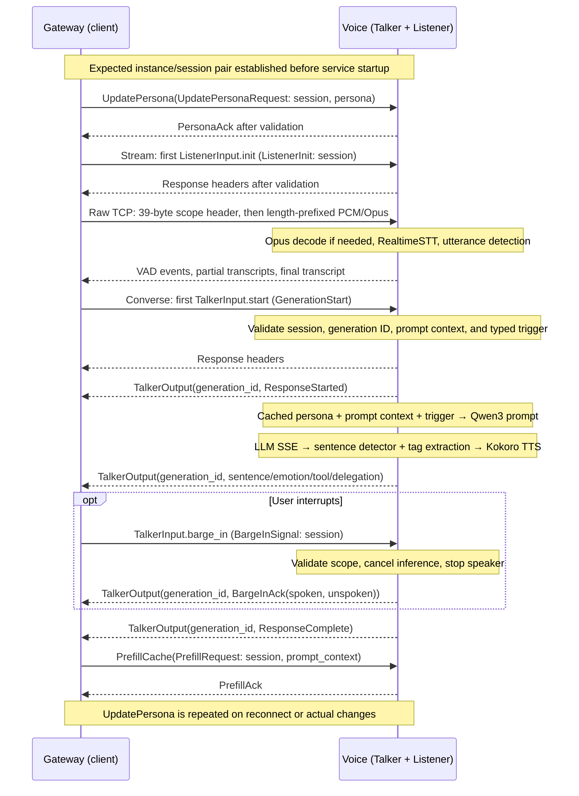

# kaguya-talker

The Kaguya voice process. Owns voice I/O and LLM inference for one fixed
instance/session pair. Each `Converse` stream handles one generation; the
process does not multiplex instances or sessions.

## Modules

- **main.py** — validates the required startup scope, then starts both gRPC
  servers and the Listener task.
- **binding.py** — immutable expected instance/session scope shared by Talker,
  Listener gRPC, and raw audio ingress. Validates request assertions and the
  audio connection preamble.
- **config.py** — `TalkerConfig` (pydantic-settings, direct-run defaults,
  `KAGUYA_*` env vars injected by launchers).
- **server.py** — `TalkerServiceServicer`: bidi `Converse` for inference +
  inline barge-in, plus unary `PrefillCache` and `UpdatePersona`.
- **voice/opus_decoder.py** — Opus → 16 kHz mono PCM (opuslib wrapper). Loads
  the system `libopus` on macOS/Linux; on Windows uses the bundled
  `native/win32/opus.dll`.
- **voice/listener.py** — Two roles in one module:
  - `ListenerServiceImpl`: gRPC server (Gateway dials us) — yields ASR events.
  - `Listener`: owns RealtimeSTT, a raw TCP socket on `:50056` for incoming
    audio frames, the turn detector, and the event queue feeding the gRPC.
- **voice/turn_detector.py** — Rule-based end-of-turn detection (Phase 1; see
  REF-004 for the planned Phase 2 learned model).
- **voice/speaker.py** — Spoken text → Kokoro TTS → audio out. Barge-in
  accounting acknowledges only completed playback batches; the interrupted
  batch and queued text stay unspoken. Exact word delivery is not measured.
- **inference/prompt_formatter.py** — `PromptContext` plus a typed generation
  trigger and cached `PersonaConfig` → Qwen3 chat-template prompt. Prefill uses
  the same snapshot renderer without a generation trigger.
- **inference/llm_client.py** — Async HTTP streaming to the OpenAI-compatible
  LLM server (`/v1/completions`).
- **inference/sentence_detector.py** — Token buffer → sentence boundaries.
- **inference/soul_container.py** — Tag extraction, emotion normalization,
  vocabulary rules.

Specs: [`../docs/spec-agent-v0.1.0.md`](../docs/spec-agent-v0.1.0.md).
Implementation plan: [`../docs/implementation-plan-v0.1.0.md`](../docs/implementation-plan-v0.1.0.md).

---

## Prerequisites

- **LLM server** — OpenAI-compatible `/v1/completions` endpoint, default
  `http://localhost:1234`. llama.cpp, LM Studio, or vLLM all work.
- **Configured scope** — standalone and managed startup both require the
  selected instance's `instance_id` and `default_session_id`. Gateway need not
  be running when voice starts, but these IDs must already be provisioned and
  must match the pair Gateway will use. Voice does not generate or choose IDs.

---

## Setup

The Talker uses **uv** for Python environment + dependency management.
On Python 3.13 you also need the `audioop-lts` backport (declared in
`pyproject.toml` with a python-version marker, so 3.11/3.12 envs skip
it automatically).

### macOS (Apple Silicon or Intel)

```sh
# 1. System libraries
brew install uv portaudio opus

# 2. Project dependencies (from talker/)
uv sync --dev

# 3. Set the required scope and run as shown in "Running" below.
```

That's it. `uv sync` reads `pyproject.toml` + `uv.lock`, downloads a
matching Python (3.11+), and creates `talker/.venv/`. `audioop-lts` and
all transitive deps install automatically. `libopus` is discovered via
`DYLD_FALLBACK_LIBRARY_PATH` — `voice/opus_decoder.py` appends both
Homebrew prefixes (`/opt/homebrew/lib`, `/usr/local/lib`) at import time.

If you also need the Rust gateway and the proto/lint tooling:

```sh
brew install buf protobuf
uv tool install ruff
uv tool install mypy
# rustup via the official installer (brew rustup-init also works):
curl --proto '=https' --tlsv1.2 -sSf https://sh.rustup.rs | sh
```

### Linux / WSL

```sh
sudo apt install build-essential portaudio19-dev libopus-dev espeak-ng
# uv installer (or apt install pipx && pipx install uv):
curl -LsSf https://astral.sh/uv/install.sh | sh
cd talker && uv sync --dev
```

| Package           | Why                                              |
| ----------------- | ------------------------------------------------ |
| `build-essential` | C compiler for PyAudio (no prebuilt linux wheel) |
| `portaudio19-dev` | PortAudio headers for PyAudio (mic capture)      |
| `libopus-dev`     | Opus codec for opuslib                           |
| `espeak-ng`       | Phoneme engine for Kokoro TTS                    |

#### WSL2 audio passthrough (mic input)

```sh
sudo apt install libasound2-plugins
echo 'pcm.default pulse
ctl.default pulse' > ~/.asoundrc
pactl info  # should report RDPSource/RDPSink (provided by WSLg)
```

Microphone access also needs to be enabled on the Windows side:
**Settings → Privacy & Security → Microphone → Let desktop apps access
your microphone**.

### Windows

`opus.dll` ships in `talker/native/win32/` — no system install needed.
Install Python 3.11+ and uv via your preferred method, then:

```powershell
cd talker
uv sync --dev
# Set the required scope and run as shown in "Running" below.
```

---

## Running

Supervisor and the dev console validate the selected manifest and inject its
pair into `KAGUYA_INSTANCE_ID` and `KAGUYA_SESSION_ID`. Runtime bind settings
come from the selected runtime configuration/profile and are also injected as
`KAGUYA_*` environment variables.

For standalone debugging, copy the values from the same `instance.toml` that
Gateway selects. Replace the placeholders below with its `instance_id` and
`default_session_id`; do not generate new IDs for the voice process.

```sh
# From talker/, macOS/Linux/WSL
export KAGUYA_INSTANCE_ID="<instance_id>"
export KAGUYA_SESSION_ID="<default_session_id>"
uv run python main.py
```

```powershell
# From talker/, Windows
$env:KAGUYA_INSTANCE_ID = "<instance_id>"
$env:KAGUYA_SESSION_ID = "<default_session_id>"
uv run python main.py
```

Both IDs are required canonical lowercase, non-nil, distinct UUIDs. Missing or
invalid values fail startup before voice dependencies load, inference clients
are created, or listeners open. There is no first-caller binding or automatic
fallback identity. Inference-only unit tests can construct `TalkerConfig`
without deployment IDs; starting the service cannot.

`config.py` defaults and `.env` remain available for direct-run settings. The
identity variables have no default; they can also be supplied in `.env`.

| Var | Default | Notes |
| --- | --- | --- |
| `KAGUYA_INSTANCE_ID` | **required** | Selected manifest's `instance_id` |
| `KAGUYA_SESSION_ID` | **required** | Selected manifest's `default_session_id` |
| `KAGUYA_LOG_LEVEL` | `INFO` | Logger level |
| `KAGUYA_LLM_BASE_URL` | `http://localhost:1234` | OpenAI-compatible endpoint |
| `KAGUYA_TALKER_LISTEN_ADDR` | `0.0.0.0:50053` | TalkerService gRPC bind address |
| `KAGUYA_LISTENER_GRPC_ADDR` | `0.0.0.0:50055` | ListenerService gRPC bind address |
| `KAGUYA_LISTENER_AUDIO_ADDR` | `0.0.0.0` | Raw TCP audio socket bind address |
| `KAGUYA_LISTENER_AUDIO_PORT` | `50056` | Raw TCP audio socket bind port |

### macOS port-binding gotcha

macOS allocates ephemeral source ports from 49152–65535 — the same range
the default Kaguya ports live in. Outbound connections (DNS lookups,
HuggingFace model fetches) can transiently hold ports as TIME_WAIT
corpses; binding to `0.0.0.0:PORT` then fails with `EADDRINUSE` because
the kernel requires the port to be free on every interface. Loopback is
its own interface and not affected. Easiest workaround:

With the required scope already exported:

```sh
KAGUYA_TALKER_LISTEN_ADDR=127.0.0.1:50053 \
KAGUYA_LISTENER_GRPC_ADDR=127.0.0.1:50055 \
KAGUYA_LISTENER_AUDIO_ADDR=127.0.0.1 \
uv run python main.py
```

Phase 1 is local-only anyway. Gateway connect-side addresses live in
`../config/kaguya.runtime.toml` under the active profile's
`processes.voice_stack.endpoints`.

---

## Development

### Regenerating proto stubs

End users **don't need this** — stubs are committed under `talker/proto/`.
Only run after editing `proto/kaguya/v1/kaguya.proto`:

```sh
# From repo root
make proto

# Or from talker/
uv run python scripts/gen_proto.py
```

The script generates Python + mypy `.pyi` stubs into `talker/proto/`
(flat layout, matching the `from proto import kaguya_pb2` imports).

### Running tests

```sh
uv run pytest -v
```

`tests/test_grpc_handshake.py` exercises stream setup against an in-process
server: valid scope/start receives headers before ASR/inference output,
malformed Talker initialization fails promptly, and an invalid replacement
cannot take over a live Listener stream.
`tests/test_instance_session_binding.py` checks typed scope rejection before
persona, cache, or speaker mutation, plus cached persona and generation
correlation. Startup and raw-audio scope validation have separate regressions.

### End-to-end text input

For end-to-end testing without a real microphone, use the Gateway's
WebSocket text-command path:

```sh
echo '{"type":"text","content":"hello"}' | websocat -n1 ws://127.0.0.1:8080/ws
```

---

## Architecture notes

- **Fixed scope.** One immutable expected pair is established before service
  startup. Every session-targeting RPC asserts that pair; a different pair is
  rejected rather than selecting another runtime. The shared binding object
  has no unbound state and never changes in response to requests.
- **Stateless generation.** Conversation state lives on Gateway. Each
  `GenerationStart` supplies a fresh `PromptContext` and exactly one typed
  trigger. Persona is cached in-process through `UpdatePersonaRequest` on
  startup, reconnect, and changes; it is not retransmitted in every generation.
- **Typed protocol.** `SessionRef` contains `InstanceId { value }` and
  `SessionId { value }`. Scope is carried in protobuf requests, not custom
  gRPC identity metadata. `GenerationStart` has `session`, `generation_id`,
  `timestamp_ms`, `prompt_context`, and a trigger `oneof`: user input, tool
  result, Reasoner result/progress/failure, or silence. Tool results retain
  `request_id`; Reasoner results/progress/failures retain `task_id`. Failures
  retain their error message and code instead of becoming successful results. `PromptContext`
  contains history, memory, tools, typed active tasks, and retrieval results.
  `PrefillRequest` carries `session` and `prompt_context` without inventing a
  generation or trigger. `UpdatePersonaRequest` carries `session` and `persona`.
- **Stream setup.** Listener accepts a bidi stream beginning with
  `ListenerInput.init` (`ListenerInit { session }`), followed by typed
  `ListenerInput.control` messages. The declared reset control currently ends
  the RPC with `UNIMPLEMENTED`; future pause/reconfiguration variants can extend
  this boundary. Talker begins with `TalkerInput.start` (`GenerationStart`),
  followed by inline `BargeInSignal` requests. Gateway queues each initial
  message before waiting for headers, and both services validate scope before
  sending them. Listener queue takeover happens only after scope validation.
  Missing, misordered, or repeated initialization is rejected. Half-closing
  Listener input leaves its event subscription active; cancellation closes it.
- **Generation provenance.** Each Converse stream serves one generation.
  Every `TalkerOutput` carries its `generation_id` in the outer envelope; Gateway
  validates it against the dispatch before forwarding the protobuf directly.
  Lifecycle payloads do not duplicate that field. A canonical UUID adds 38 bytes
  per semantic output, including barge-in acknowledgments, with no audio overhead.
  Listener's local `utterance_epoch` counter invalidates stale silence loops;
  it is unrelated to generation IDs.
- **Two gRPC servers, one process.** `TalkerService` on `:50053` and
  `ListenerService` on `:50055` run in the same asyncio loop. They share the
  fixed scope and the voice process's resources.
- **Audio bypass.** Raw 16-bit PCM/Opus frames do not go through gRPC at
  50fps. They use a dedicated TCP socket (`:50056` by default). Gateway sends
  one 39-byte header (`KAGUYA1` plus binary InstanceId and SessionId);
  length-prefixed frames follow. The header must match the startup scope
  before frames reach the recorder. This adds connection setup bytes rather
  than bytes to each audio frame; no latency benchmark is implied.
- **opus.dll on Windows.** Bundled in `native/win32/`, prepended to `PATH`,
  and registered via `os.add_dll_directory()` at import time so opuslib's
  `find_library` resolves it without system installation.
- **Proto imports.** Use the flat `from proto import kaguya_pb2` form
  (single source of truth in `talker/proto/`).

### Data flow



See [`../REFERENCES.md`](../REFERENCES.md) for design decision rationale.
